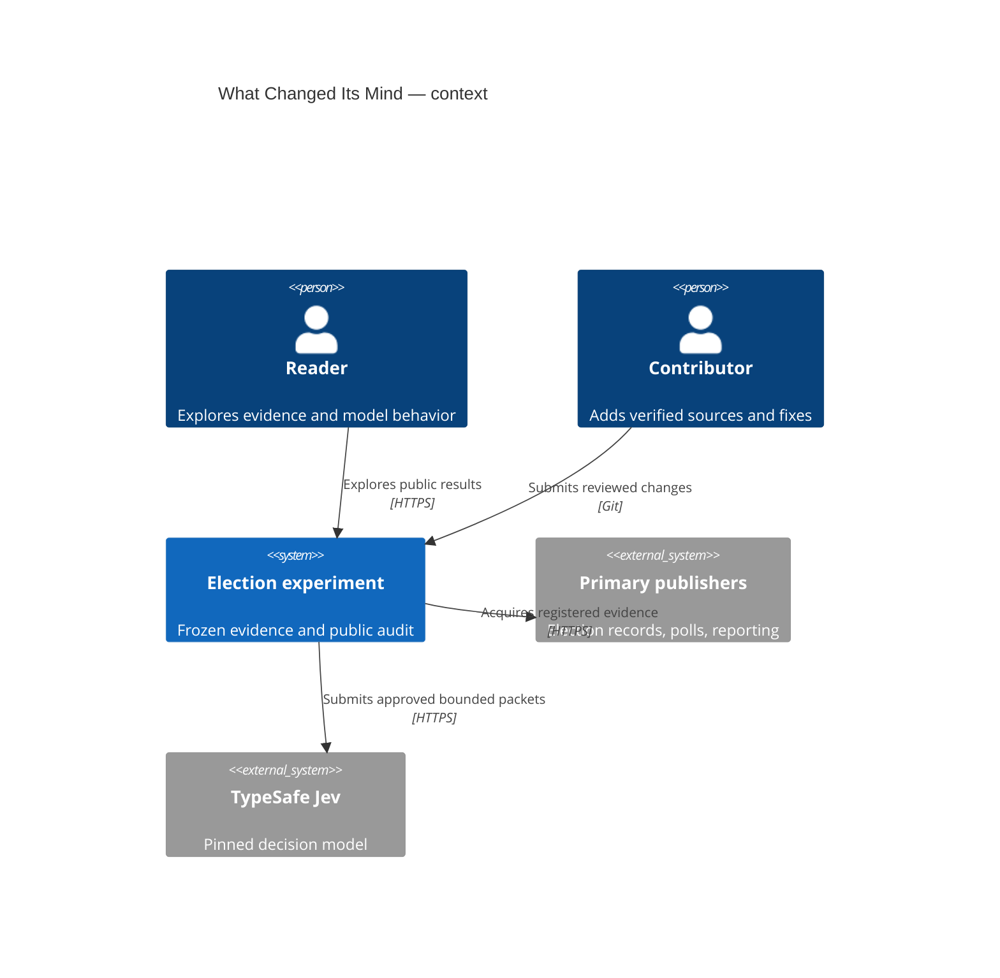
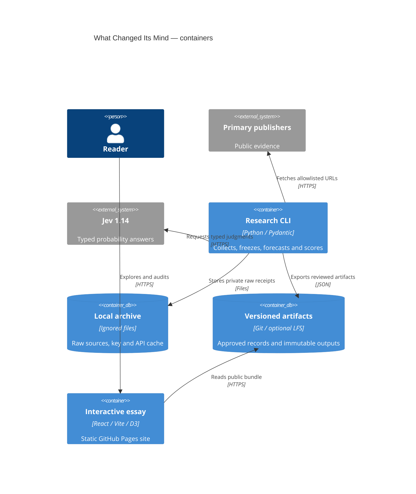

# Architecture

## Context

## Containers

Classifications annotate browsing; forecasts consume original approved evidence. Certified outcomes enter scoring only. No browser-side API key, database or server-side inference. Data flow and privacy boundaries are enforced in snapshot/export modules, not by display conventions.
